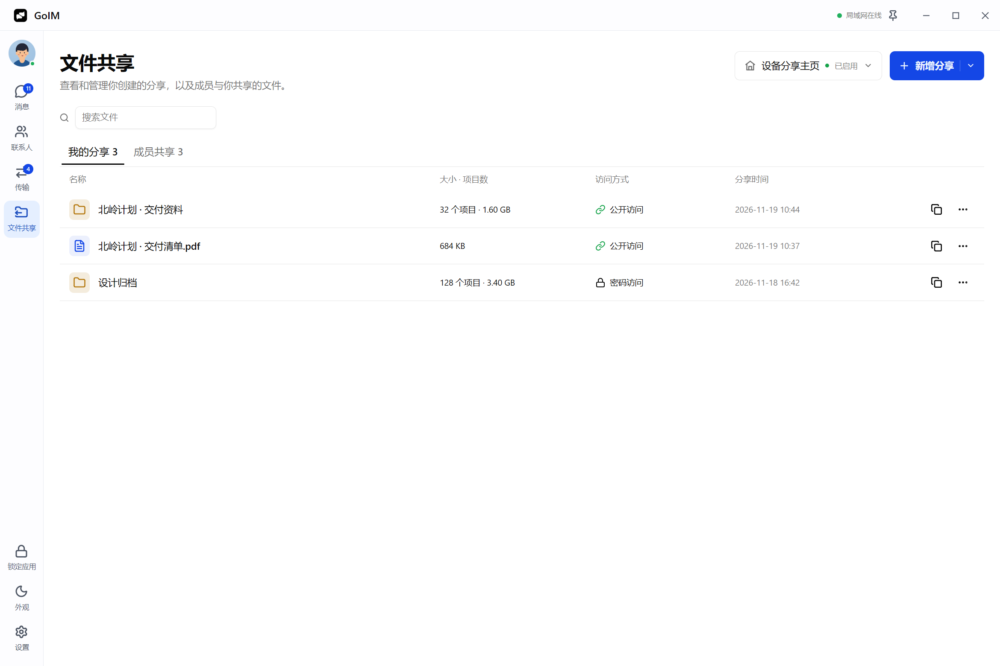

<!-- The gallery uses GoIM's native headless renderer with synthetic demo data. -->
<div align="center">
  <p>English · <a href="README.md">简体中文</a></p>
  
  <h1>GoIM</h1>
  <p><strong>Local network messaging and file sharing</strong></p>
  <p>
    <a href="https://ezreal-byte.github.io/GoIM/en/">Website</a> ·
    <a href="https://github.com/Ezreal-byte/GoIM/releases/latest">Download</a> ·
    <a href="#quick-start">Quick start</a> ·
    <a href="#legacy-compatibility">Compatibility</a>
  </p>
  <a href="website/assets/screenshots/chat-light.png">
    <picture>
      <source media="(prefers-color-scheme: dark)" srcset="website/assets/screenshots/chat-dark.png" />
      
    </picture>
  </a>
  <p><sub>The native GoIM interface, rendered headlessly with demo data.</sub></p>
</div>

GoIM is a desktop messenger built with Go and [Viva](https://github.com/vivaui/viva). Devices discover each other on the LAN, exchange messages and files directly, and keep their chat history locally. Recipients can open file shares in a browser.

<table>
  <tr>
    <td width="50%"><a href="website/assets/screenshots/contacts-light.png"></a><strong>Contacts</strong></td>
    <td width="50%"><a href="website/assets/screenshots/transfers-dark.png"></a><strong>Transfers</strong></td>
  </tr>
  <tr>
    <td width="50%"><a href="website/assets/screenshots/shares-light.png"></a><strong>File sharing</strong></td>
    <td width="50%"><a href="website/assets/screenshots/chat-dark.png"></a><strong>Dark appearance</strong></td>
  </tr>
</table>

## Features

| Messaging | Transfers and sharing |
| --- | --- |
| Direct and group chats, invitations, and membership controls | Receive prompts, Save As, cancel, retry, and resume |
| Text, emoji, and inline images with a separate viewer for zoom, rotate, and save | TLS and SHA-256 verification between GoIM clients |
| Local history, search, unread counts, pinned conversations, and offline retry | File and folder links, QR codes, and per-project passwords |
| Contact groups, profiles, app lock, light and dark appearances, and Chinese and English UI | Device share homepage with browser uploads |

Capture a region, resize it, annotate it, and copy at the original resolution. Use the scissors in the composer or the default `Alt+A` shortcut.

## Install

Choose your platform and architecture from [GitHub Releases](https://github.com/Ezreal-byte/GoIM/releases/latest).

| Platform | Architecture | Package formats |
| --- | --- | --- |
| Windows | x64, ARM64 | `Setup.exe`, `.zip` |
| macOS 13 or later | Intel, Apple silicon | `.dmg`, `.zip` |
| Linux (X11 or XWayland) | x64, ARM64 | `.deb`, `.tar.gz` |

Linux packages use Viva's pure-Go build path and do not require GLIBC 2.32 or 2.34. Release validation permits only the baseline libc, libpthread, and libdl dependencies and rejects symbol requirements newer than GLIBC 2.31. The system must still provide the libc, X11, XKB, and Vulkan runtime libraries listed by the DEB dependencies. Kylin and UOS use the same compatibility build.

Windows uses Viva's `Setup.exe`, which installs for the current user. Uninstall standalone MSI builds before switching to Setup. GoIM stores profiles and chat history in a separate user data folder.

For archives, extract the full package so GoIM can find its screenshot tool. Windows packages have no commercial code signature. macOS uses ad-hoc signing and requires the usual local approval for unnotarized apps. Verify downloads with the release's `SHA256SUMS`.

## Quick start

1. Run GoIM on two devices on the same reachable LAN.
2. Select the other device in **Contacts**. If discovery is unavailable, use **Connect manually** with its IP or `IP:47842`.
3. Send a message or image. Receive other attachments in the conversation or on the **Transfers** page.
4. To share with a phone or a browser, add a file or folder in **File Sharing**, then copy its link or QR code. The optional device homepage also accepts uploads.

Native chat uses TCP 47842 and IPv4 multicast at `239.192.77.77:47841` for discovery. Browser sharing uses LAN HTTP on trusted networks.

## Legacy compatibility

GoIM chooses the wire protocol from the peer. There is no per-contact compatibility selector and no manual identity-linking step.

| Peer | Route |
| --- | --- |
| GoIM | Native GoIM TLS protocol |
| Neiwangtong (内网通) | Native Neiwangtong protocol: UDP 9011 discovery, ENet 9012 control, TCP 9013 avatar and file streams |
| FeiQ (飞秋) / IP Messenger | Standard IPMSG on port 2425 |

The adapter state below is scoped to the original Neiwangtong 3.4.3055 client. “Verified” means the listed behavior passed the automated original-client sandbox, including result files, persisted chat records, hashes, or protocol receipts; packet captures do not count as a pass by themselves.

| Capability | Status | Automated evidence |
| --- | --- | --- |
| Discovery, online and offline transitions, profile exchange, native avatar download | Verified | No manual address; the same contact was updated after the original exited and restarted. Handshake and image digests checked |
| Direct text, Chinese text, special characters, delivery receipts | Verified in both directions | Sent and received records matched with application receipts |
| Direct and group text recall | Verified in both directions | The recalled text disappeared and the neighboring control message remained |
| Online individual files, reject, recall and cancel | Verified in both directions | Real files compared by SHA-256 |
| Inline PNG, JPEG and GIF messages | Verified in both directions | Original-client cache and received bytes compared exactly |
| Directory transfer | Verified in both directions | Nested Chinese paths, empty subdirectories and zero-byte files preserved |
| Restarting an interrupted directory transfer | Verified in both directions | A fresh offer restarted the transfer; received files matched by SHA-256 |
| Busy and away presence, avatar replacement | Original presence → GoIM and avatar replacement in both directions verified | The same contact changed presence in sequence. Both clients received two replacements; GoIM cleared its copy when the original restored its default avatar |
| Individual file resume | Verified in both directions | Non-zero offsets and final SHA-256 checks; GoIM retries reuse the file's original task ID |
| Offline text and file replay | Verified in both directions | Both clients restarted with isolated profiles |
| Original-client-created group chat | Text and inline PNG, JPEG, and GIF verified in both directions | Text matched the original transcript; the original cache and GoIM downloads matched the image samples |
| Neiwangtong group created in GoIM | Creation, member addition, renaming, three-client text and original-client exit verified | Two originals and GoIM exchanged messages. Renaming kept the conversation, and when one original left the other stayed in the group |
| Group dismissal and member removal | Verified against the original for GoIM-initiated actions; original commands and GoIM state also tested | The original closed the affected group window. GoIM accepts these actions only from the owner and retains local history |
| Regular group files | Verified in both directions | Files sent and accepted in a group matched the source SHA-256 on disk |
| Original built-in emoticons | Mapping for 84 IDs implemented; the smile verified in both directions | Neiwangtong receives its native symbol; GoIM renders its own emoji or descriptive text |
| Files larger than 4 GiB | Original → GoIM verified | 4,295,032,849-byte file downloaded and hashed |

Group folders also passed both directions against the original, preserving nested Chinese paths, empty subdirectories and zero-byte files. Group file invitations remain downloadable after GoIM restarts.

Known gaps include GoIM → original transfers of 4 GiB or more, resuming directories, fully empty root directories, group file and folder resume, group ownership transfer, custom expression packs, native shared-directory browsing and remote assistance.

FeiQ/IP Messenger uses standard IPMSG. Original IP Messenger `5.9.1` passed automatic discovery, Chinese messages in both directions, and real file downloads. Development after `0.1.7` adds matched delivery receipts and stable packet numbers across restarts. Specific FeiQ versions still need validation; see the [compatibility progress](docs/ipmsg-compatibility-progress.md). These later changes are not included in the `0.1.7` packages.

See the detailed [Neiwangtong compatibility progress](docs/neiwangtong-compatibility-progress.md) and the [automated Neiwangtong test guide](docs/neiwangtong-testing.md). The adapters can be managed under **Settings → Network**; `--no-compatibility` starts a GoIM-only instance.

## Build from source

Use the Go version pinned by CI (currently 1.27.3). Go downloads the exact Viva revision from [`go.mod`](go.mod). When working on Viva itself, you can make a local Go workspace that includes both repositories.

```sh
go test ./... -count=1
go vet ./...
go run ./cmd/goim
```

On Windows, `pwsh -File scripts/start-temp-dev.ps1` builds and starts a client with its own profile and download directory. Add `-Loopback` to disable LAN discovery and legacy adapters, or run `scripts/start-dual.ps1` for two clients connected over loopback.

`pwsh -File scripts/smoke-headless.ps1` builds a fresh headless client and runs a three-process test of messaging, file transfer, and browser sharing. Use `scripts/build.ps1` to build the desktop app and screenshot companion without starting them, or `scripts/promo-headless.ps1` to regenerate the demo gallery. See [Actions](https://github.com/Ezreal-byte/GoIM/actions/workflows/build.yml) for platform packaging and validation.

## License

[MIT](LICENSE) · [Third-party notices](THIRD_PARTY_NOTICES.md)
