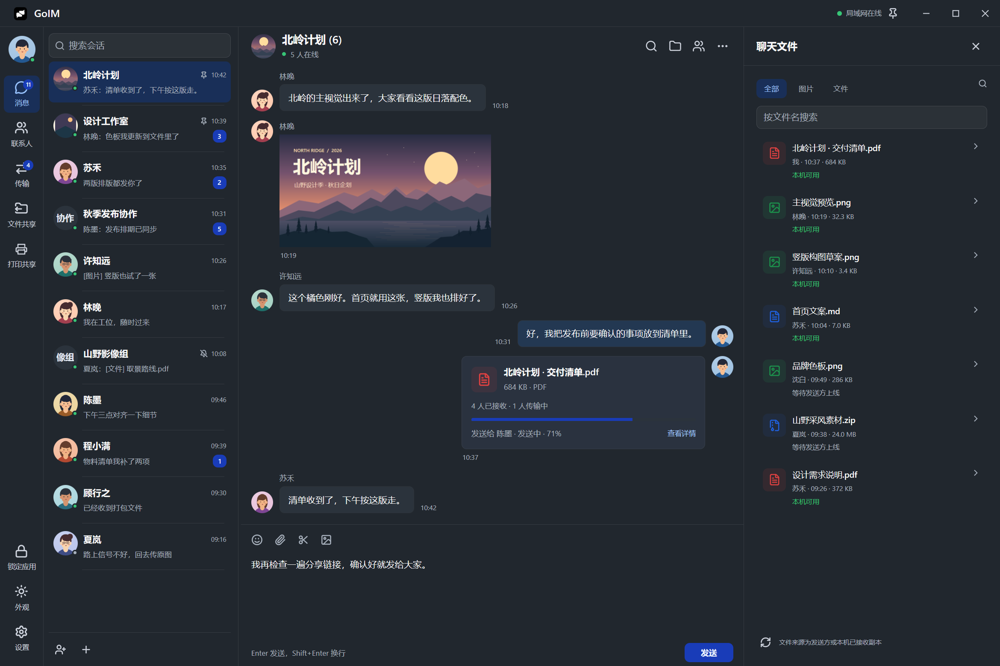
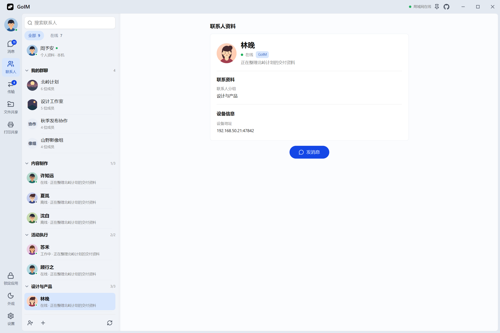
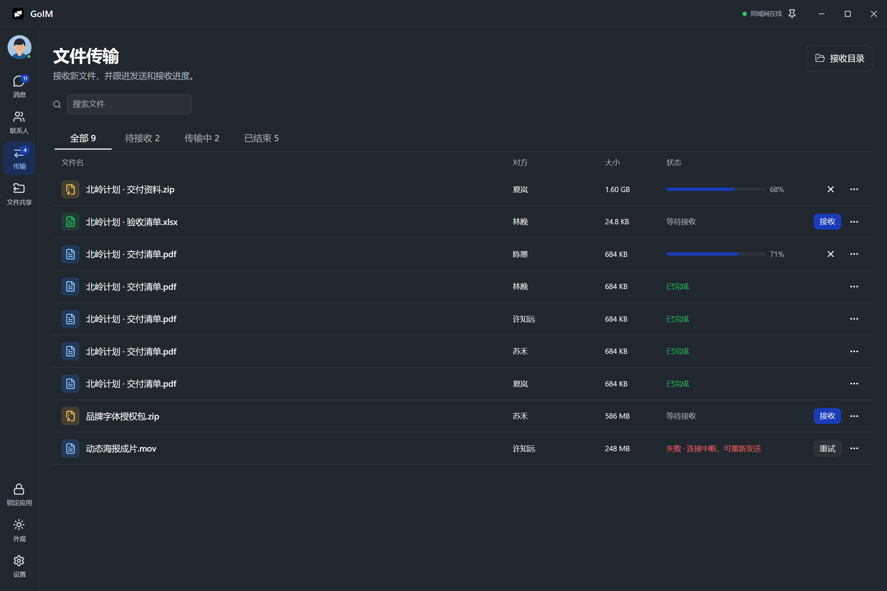
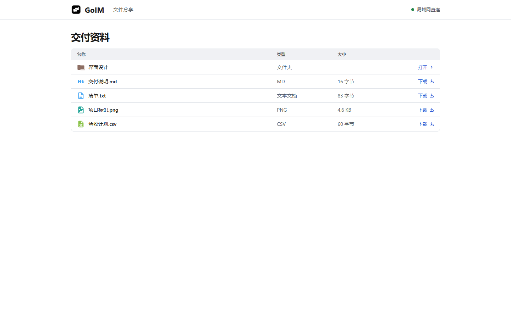
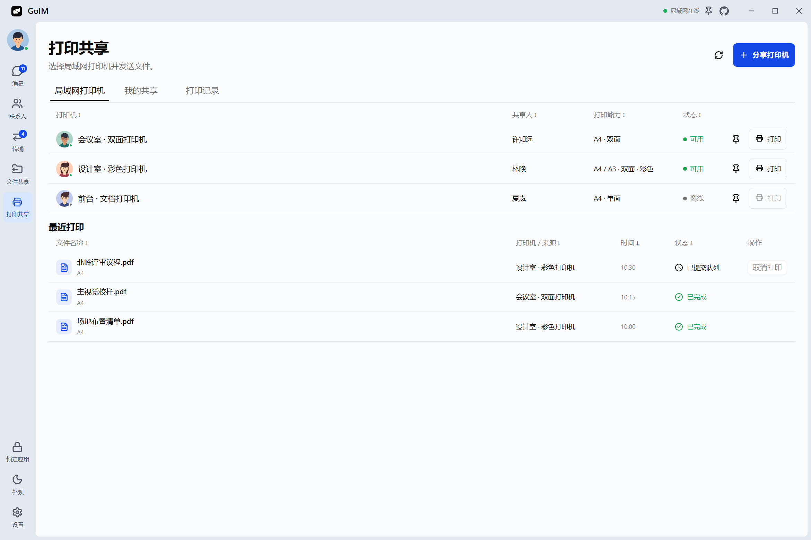
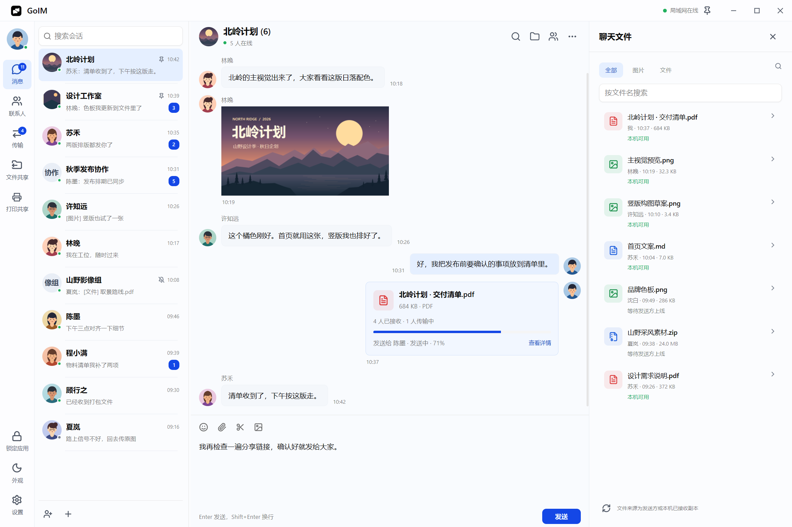

<div align="center">
  <p>English · <a href="README.md">简体中文</a></p>
  
  <h1>GoIM</h1>
  <p><strong>Local network messaging and file sharing</strong></p>
  <p>
    <a href="https://ezreal-byte.github.io/GoIM/en/">Website</a> ·
    <a href="https://github.com/Ezreal-byte/GoIM/releases/latest">Download</a> ·
    <a href="#quick-start">Quick start</a> ·
    <a href="#legacy-compatibility">Compatibility</a>
  </p>
  <p>
    <a href="https://qm.qq.com/cgi-bin/qm/qr?k=&amp;group_code=1084364974"></a>
    <a href="https://www.kdocs.cn/l/cdcdb0XI3TTt"></a>
    <a href="https://linux.do/"></a>
  </p>
  <a href="website/assets/screenshots/chat-dark.png">
    
  </a>
</div>

GoIM is a desktop messenger built with Go and [Viva](https://github.com/vivaui/viva). Devices discover each other on the LAN, exchange messages and files directly, and keep their chat history locally. Recipients can open file shares in a browser.

<table>
  <tr>
    <td width="50%"><a href="website/assets/screenshots/contacts-light.png"></a><strong>Contacts</strong></td>
    <td width="50%"><a href="website/assets/screenshots/transfers-dark.png"></a><strong>Transfers</strong></td>
  </tr>
  <tr>
    <td width="50%"><a href="website/assets/screenshots/shares-light.png"></a><strong>Desktop file sharing</strong></td>
    <td width="50%"><a href="website/assets/screenshots/lan-share-directory.png"></a><strong>LAN file sharing in a browser</strong></td>
  </tr>
  <tr>
    <td width="50%"><a href="website/assets/screenshots/print-sharing.png"></a><strong>Printer sharing</strong></td>
    <td width="50%"><a href="website/assets/screenshots/chat-light.png"></a><strong>Light appearance</strong></td>
  </tr>
</table>

## Features

| Messaging | Transfers and sharing |
| --- | --- |
| Direct and group chats, invitations, and membership controls | Receive prompts, Save As, cancel, retry, and resume |
| Text, emoji, and inline images with a separate viewer for zoom, rotate, and save | TLS and SHA-256 verification between GoIM clients |
| Local history, search, unread counts, pinned conversations, and offline retry | File and folder links, QR codes, and per-project passwords |
| Contact groups, profiles, app lock with system verification, light and dark appearances, and Chinese and English UI | Device share homepage with browser uploads |

Direct chats support two-way voice calls with incoming-call acceptance, hang-up, microphone mute, and speaker controls. Choose the default microphone and speaker and adjust input or playback volume in **Settings → Calls**.

**Print Sharing** lets members share local printers and choose a file and print options in a separate window. Pin frequently used printers from their cards. Owners can set, change, or remove an optional password under **My shares → Edit share**. Protected printers require verification on first use and after a password change; a printer-specific authorization is saved locally instead of the plaintext password. Both sides retain print history. Files are not accepted or submitted to the system print queue before authorization succeeds.

Use `Alt+A` or the scissors in the composer to capture your screen. Windows and macOS 13.3 or later use the bundled Shotlet helper for annotation, scrolling capture, OCR, and pinning. Confirm a screenshot to paste it into a chat. Shotlet supports recording on Windows and macOS 15 or later. Linux and macOS 13.0–13.2 use GoIM's built-in tool. On macOS, grant screen recording permission for Shotlet on first use.

## Install

Choose your platform and architecture from [GitHub Releases](https://github.com/Ezreal-byte/GoIM/releases/latest).

| Platform | Architecture | Package formats |
| --- | --- | --- |
| Windows | x64, ARM64 | `Setup.exe`, `.zip` |
| macOS 13 or later | Intel, Apple silicon | `.dmg`, `.zip` |
| Linux (X11 or XWayland) | x64, ARM64 | `.deb`, `.tar.gz` |

Linux packages use Viva's pure-Go build path and do not require GLIBC 2.32 or 2.34. Release validation permits only the baseline libc, libpthread, and libdl dependencies and rejects symbol requirements newer than GLIBC 2.31. The system must still provide the libc, X11, XKB, Vulkan, and ALSA (`libasound2`) runtime libraries listed by the DEB dependencies. Kylin and UOS use the same compatibility build.

Linux file dialogs prefer the desktop's XDG Portal or an installed zenity/kdialog. Both `.deb` and `.tar.gz` packages include a file dialog helper and its runtime libraries, used automatically when neither system helper is installed. Installing or using the bundled helper needs no network access or extra zenity/kdialog installation. Fully extract portable packages and keep the `lib/goim/file-dialog` directory. Under **Settings → About**, you can copy a redacted diagnostic report. If the save dialog is unavailable, exporting saves the report to the default download folder and shows its path (or the app data folder's `diagnostics` subfolder if no download folder is configured).

Windows uses Viva's `Setup.exe`, which installs for the current user. Uninstall standalone MSI builds before switching to Setup. GoIM stores profiles and chat history in a separate user data folder.

For archives, extract the full package so GoIM can find its screenshot tool. Windows packages have no commercial code signature. macOS uses ad-hoc signing and requires the usual local approval for unnotarized apps. Verify downloads with the release's `SHA256SUMS`.

### Software updates

Automatic update checks are enabled by default and run at startup and every 6 hours. Failed checks retry after 30 minutes. Disable automatic checks or check manually under **Settings → About**; enabling the switch starts a check immediately. Downloading and installing updates still require user action.

Windows and Linux installers check for running GoIM instances before replacing files. Exit every instance, including its tray icon, then retry installation. In-app updates exit the current instance before the update helper installs and restarts it. Linux DEB updates continue to use the system package manager.

### Clear local data

**Settings → About → Clear all user data** requires a second confirmation. **Clear and exit** stops networking and background tasks, closes the database, then clears this device's identity key, contacts, chats, passwords, settings and app-data caches. Start GoIM again to create a new identity, which other devices will recognize as a new user. Downloaded files, shared originals and screenshot files are kept; other devices are unaffected. If shutdown is interrupted, the next launch finishes the confirmed reset.

## Quick start

1. Run GoIM on two devices on the same reachable LAN.
2. Use the search field at the top of **Contacts** to find the other device. If discovery is unavailable, choose **Connect by IP** at the bottom of the sidebar and enter its IP or `IP:47842`.
3. Send a message or image. Receive other attachments in the conversation or on the **Transfers** page.
4. In **File sharing → Member shares**, open a shared folder, unlock it if prompted, and choose the files to download. Chat videos under 500 MiB are received automatically. Click a received video to play it in the media viewer.
5. Add a file or folder in **File sharing**, then copy its link or show its QR code. To share several items from one page, choose **Device sharing → Enable device page** and copy the homepage link. Anyone on the same LAN with the link can browse the directory and download files. To send you a file, use the upload button at the top right or drag the file into the directory.
6. To use a colleague’s printer, open **Print sharing**, choose an available printer with the paper, color and duplex options you need, then click **Print** to select a file. Check its status under **Recent prints**.

Native chat uses TCP 47842 and IPv4 multicast at `239.192.77.77:47841` for discovery. Browser sharing uses LAN HTTP on trusted networks.

### Discover GoIM across routed subnets

Publish a DNS SRV record for an always-on GoIM entry point and an A or AAAA record for its host. For example:

```dns
_goim._tcp.office.example.  60 IN SRV 0 0 47842 entry.office.example.
entry.office.example.       60 IN A   10.10.1.20
```

Cross-subnet discovery is off by default. To enable it, turn on automatic discovery and set the internal DNS server and discovery domain on the entry point and all participating clients under **Settings → Network → Advanced network settings → Cross-subnet discovery**. The default domain is `goim.internal`. The resolver accepts an IP or an IP and port (default 53). The setting applies only to GoIM. Once registered, clients discover other online participants and connect directly over TLS. Clients and the entry point need a version supporting this feature, a route to the resolver, and TCP access to each other's GoIM listening port. Invisible mode pauses registration. Clear the server and save to leave the directory.

## App lock and system verification

Set a GoIM lock password under **Settings → Security → App lock**, then enable **Use system verification to unlock**. Enabling it requires your current GoIM password. On the lock screen, choose **Use system verification**, or continue using the GoIM password. Canceling or failing verification leaves GoIM locked.

| System | Available system verification |
| --- | --- |
| Windows 11 | Windows Hello with a configured PIN, fingerprint, or face |
| Windows 10 | Desktop Hello verification requires Windows 11; use the GoIM password when system verification is unavailable |
| macOS | Touch ID, or the current macOS login password when Touch ID is unavailable |
| Linux | System verification is unavailable in this version. The switch is disabled with an explanation; use the GoIM lock password |

GoIM receives only the verification result and never reads, stores, or transmits system passwords or biometric data. Existing Linux system-verification settings are turned off automatically while GoIM lock passwords are kept. The bundled polkit policy does not enable this unavailable feature. Windows Hello must be enabled in Windows first; the Windows account password is not passed to GoIM as a Hello credential.

## Legacy compatibility

GoIM selects the protocol for each peer automatically. The interoperability features below ship in `0.1.17` and have been verified with the original clients.

| Client | Verified behavior | Details |
| --- | --- | --- |
| Neiwangtong (内网通) `3.4.3055` | Automatic discovery. Direct and group chats exchange text, images, files and folders in both directions. Direct file transfers over 4 GiB also passed. | [Neiwangtong compatibility](docs/neiwangtong-compatibility-progress.md) |
| IP Messenger `5.9.1` | Automatic discovery, two-way Chinese messages and file transfers. | [IP Messenger compatibility](docs/ipmsg-compatibility-progress.md) |
| FeiQ 2013 (`3.0.0.2`) | Discovery at a specified loopback address, two-way Chinese messages and file transfers with Chinese filenames. Broadcast discovery between machines still needs verification. | [FeiQ verification and limits](docs/ipmsg-compatibility-progress.md#windows-飞秋联调) |

Manage legacy clients under **Settings → Network**, or start GoIM with `--no-compatibility` to use only its native protocol.

## Build from source

Use the Go version pinned by CI (currently 1.27.3). Go downloads the exact Viva revision from [`go.mod`](go.mod). When working on Viva itself, you can make a local Go workspace that includes both repositories.

```sh
go test ./... -count=1
go vet ./...
go run ./cmd/goim
```

On Windows, `pwsh -File scripts/start-temp-dev.ps1` builds and starts a client with its own profile and download directory. Add `-Loopback` to disable LAN discovery and legacy adapters, or run `scripts/start-dual.ps1` for two clients connected over loopback.

Windows and macOS packaging builds the Shotlet capture SDK helper from pinned revisions with CMake 3.20 or later. Windows needs Visual Studio C++ tools for the target architecture and the Windows SDK. Visual Studio 2026 requires CMake 4.2 or later. macOS needs the Xcode Command Line Tools. Install NSIS to build Windows Setup with `go run ./cmd/package --windows-setup`. Linux builds use the existing GoIM toolchain because Shotlet's Wayland capture and native selection overlay are incomplete. [Shotlet source](https://github.com/Ezreal-byte/shotlet)

`pwsh -File scripts/smoke-headless.ps1` tests messaging, file transfer and browser sharing across three processes. Use `scripts/build.ps1` to build the desktop app and screenshot companion. See [Actions](https://github.com/Ezreal-byte/GoIM/actions/workflows/release.yml) for platform packaging and validation.

See the [release guidelines](docs/releases/README.md) for the release notes format.

## Acknowledgements

Thanks to [t8y2 / Viva](https://github.com/vivaui/viva) for the native Go desktop framework that powers GoIM’s chat windows and desktop controls.

Thanks to [imjakey / Shotlet](https://github.com/imjakey/shotlet) for the open-source screenshot tool. GoIM integrates a Shotlet-based capture helper on Windows and macOS.

## License

[Apache License 2.0](LICENSE) · [Third-party notices](THIRD_PARTY_NOTICES.md)
