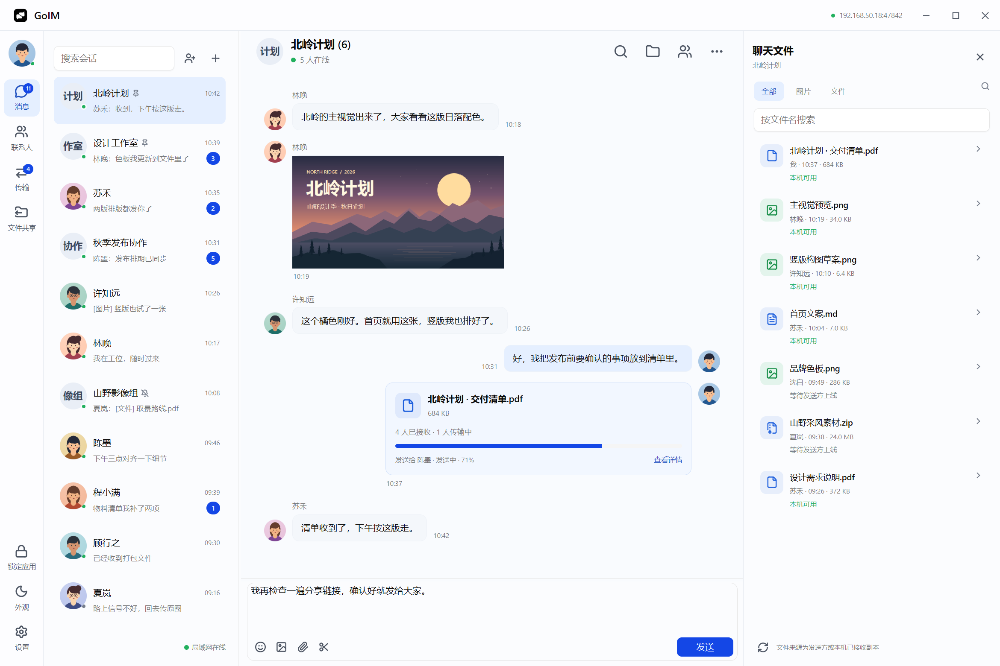
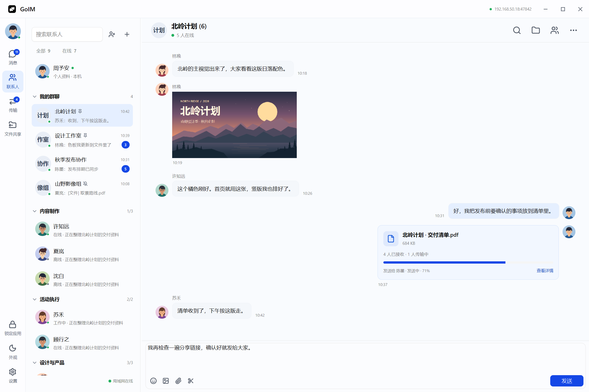
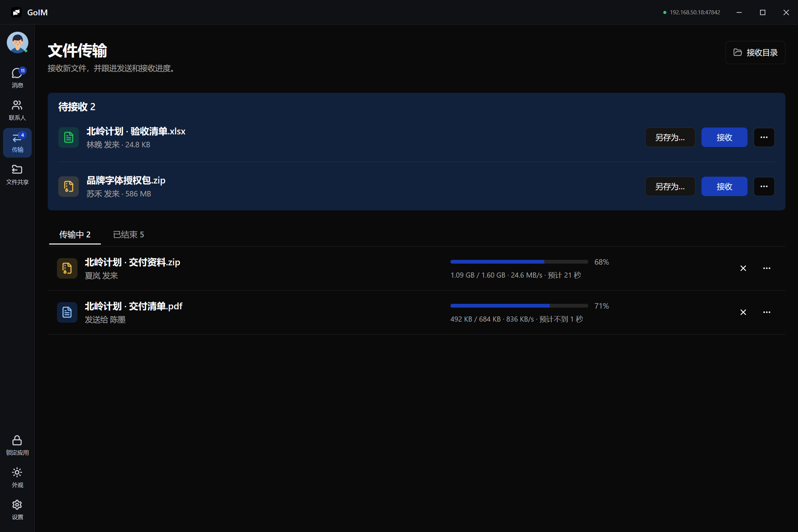
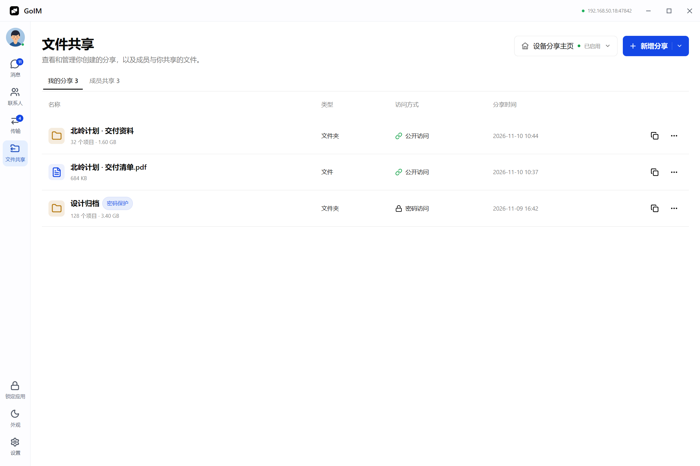
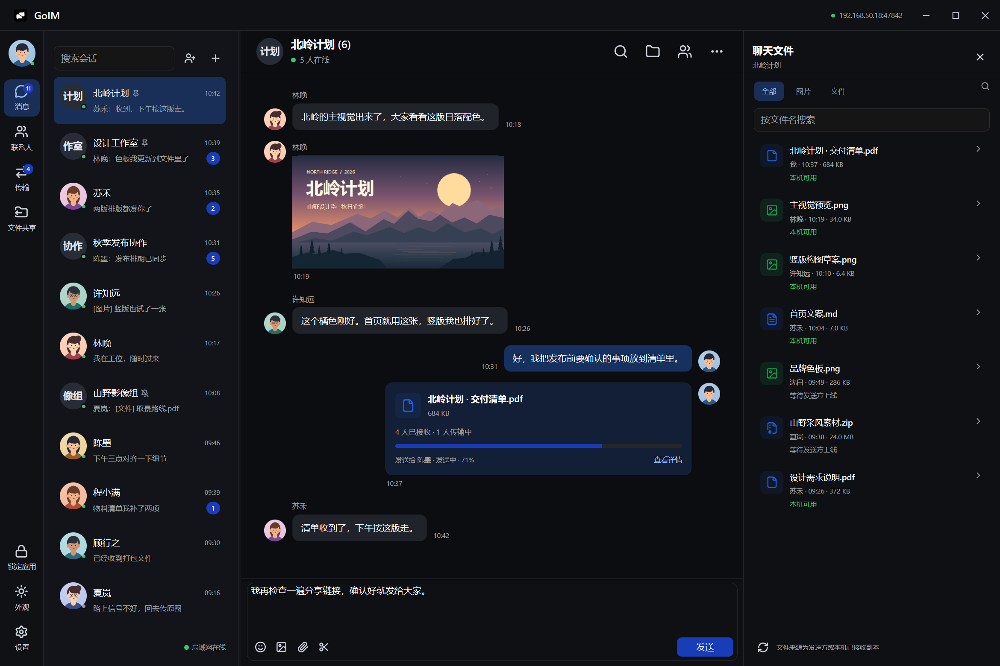

<!-- The gallery uses GoIM's native headless renderer with synthetic demo data. -->
<div align="center">
  <p>English · <a href="README.zh-CN.md">简体中文</a></p>
  
  <h1>GoIM</h1>
  <p><strong>Local network messaging and file sharing</strong></p>
  <p>
    <a href="https://ezreal-byte.github.io/GoIM/en/">Website</a> ·
    <a href="https://github.com/Ezreal-byte/GoIM/releases/latest">Download</a> ·
    <a href="#quick-start">Quick start</a> ·
    <a href="#legacy-compatibility">Compatibility</a>
  </p>
  <a href="website/assets/screenshots/chat-light.png">
    <picture>
      <source media="(prefers-color-scheme: dark)" srcset="website/assets/screenshots/chat-dark.png" />
      
    </picture>
  </a>
  <p><sub>The native GoIM interface, rendered headlessly with demo data.</sub></p>
</div>

GoIM is a desktop messenger built with Go and [Viva](https://github.com/vivaui/viva). Devices discover each other on the LAN, exchange messages and files directly, and keep their chat history locally. Recipients can open file shares in a browser.

<table>
  <tr>
    <td width="50%"><a href="website/assets/screenshots/contacts-light.png"></a><strong>Contacts</strong></td>
    <td width="50%"><a href="website/assets/screenshots/transfers-dark.png"></a><strong>Transfers</strong></td>
  </tr>
  <tr>
    <td width="50%"><a href="website/assets/screenshots/shares-light.png"></a><strong>File sharing</strong></td>
    <td width="50%"><a href="website/assets/screenshots/chat-dark.png"></a><strong>Dark appearance</strong></td>
  </tr>
</table>

## Features

| Messaging | Transfers and sharing |
| --- | --- |
| Direct and group chats, invitations, and membership controls | Receive prompts, Save As, cancel, retry, and resume |
| Text, emoji, and inline images with a separate viewer for zoom, rotate, and save | TLS and SHA-256 verification between GoIM clients |
| Local history, search, unread counts, pinned conversations, and offline retry | File and folder links, QR codes, and per-project passwords |
| Contact groups, profiles, app lock, light and dark appearances, and Chinese and English UI | Device share homepage with browser uploads |

Capture a region, resize it, annotate it, and copy at the original resolution. Use the scissors in the composer or the default `Alt+A` shortcut.

## Install

Choose your platform and architecture from [GitHub Releases](https://github.com/Ezreal-byte/GoIM/releases/latest). v0.1.1 ships 14 installers and archives in the formats below.

| Platform | Architecture | Package formats |
| --- | --- | --- |
| Windows | x64, ARM64 | `Setup.exe`, `.msi`, `.zip` |
| macOS 13 or later | Intel, Apple silicon | `.dmg`, `.zip` |
| Linux (X11 or XWayland) | x64, ARM64 | `.deb`, `.tar.gz` |

Choose either Setup or MSI on Windows. For archives, extract the full package so GoIM can find its screenshot tool. Windows packages have no commercial code signature. macOS uses ad-hoc signing and requires the usual local approval for unnotarized apps. Verify downloads with the release's `SHA256SUMS`.

## Quick start

1. Run GoIM on two devices on the same reachable LAN.
2. Select the other device in **Contacts**. If discovery is unavailable, use **Connect manually** with its IP or `IP:47842`.
3. Send a message or image. Receive other attachments in the conversation or on the **Transfers** page.
4. To share with a phone or a browser, add a file or folder in **File Sharing**, then copy its link or QR code. The optional device homepage also accepts uploads.

Native chat uses TCP 47842 and IPv4 multicast at `239.192.77.77:47841` for discovery. Browser sharing uses LAN HTTP on trusted networks.

## Legacy compatibility

| Client | Verified | Limits |
| --- | --- | --- |
| Neiwangtong (内网通) 3.4.3055 | Initial Windows/VMware tests verified discovery, text and individual files in both directions. Regression tests cover the TCP request format and chat attachment cards. | Images can travel as ordinary attachments. Proprietary inline media, screenshots, stickers, native share browsing and group chats are outside the adapter. |
| FeiQ (飞秋) | Automated coverage for the extended header, Chinese encoding, discovery, and the standard IPMSG file path. | The FeiQ desktop client and version-specific extensions still need hands-on verification. |

Enter `IPv4:2425` for a legacy peer when automatic discovery is unavailable. Legacy discovery and text use UDP 2425, and file downloads use TCP 2425. Run one legacy-enabled client per host to avoid port conflicts. The IPMSG adapter uses plain LAN traffic and can be disabled with `--no-ipmsg`.

## Build from source

Use the Go version pinned by CI (currently 1.27.3). Set up the pinned Viva checkout next to GoIM and apply the patches in the [framework instructions](framework/README.md).

```sh
go test ./... -count=1
go vet ./...
go run ./cmd/goim
```

On Windows, `pwsh -File scripts/build.ps1` builds the desktop app and the screenshot companion. Regenerate the demo gallery with `pwsh -File scripts/promo-headless.ps1`. See [Actions](https://github.com/Ezreal-byte/GoIM/actions/workflows/build.yml) for platform packaging and validation.

## License

[MIT](LICENSE) · [Third-party notices](THIRD_PARTY_NOTICES.md)
