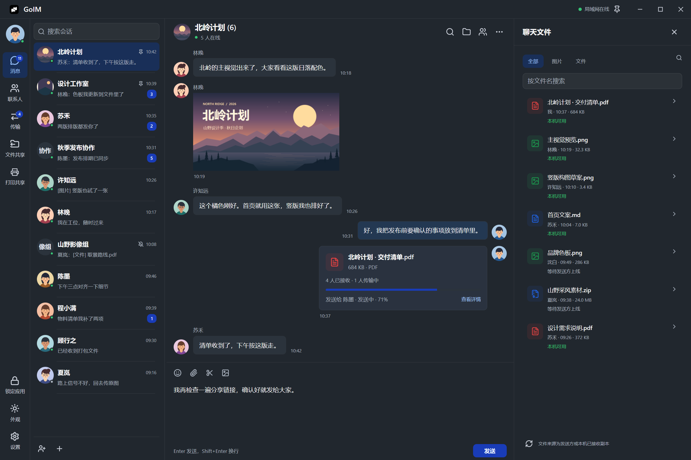
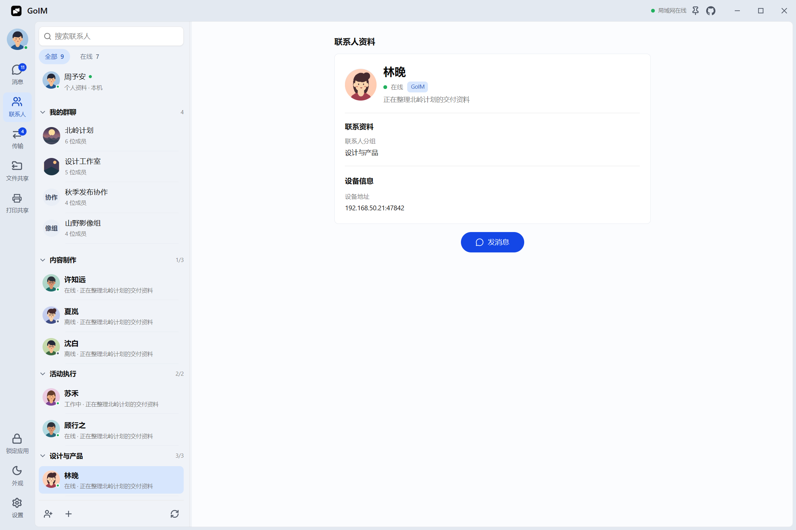
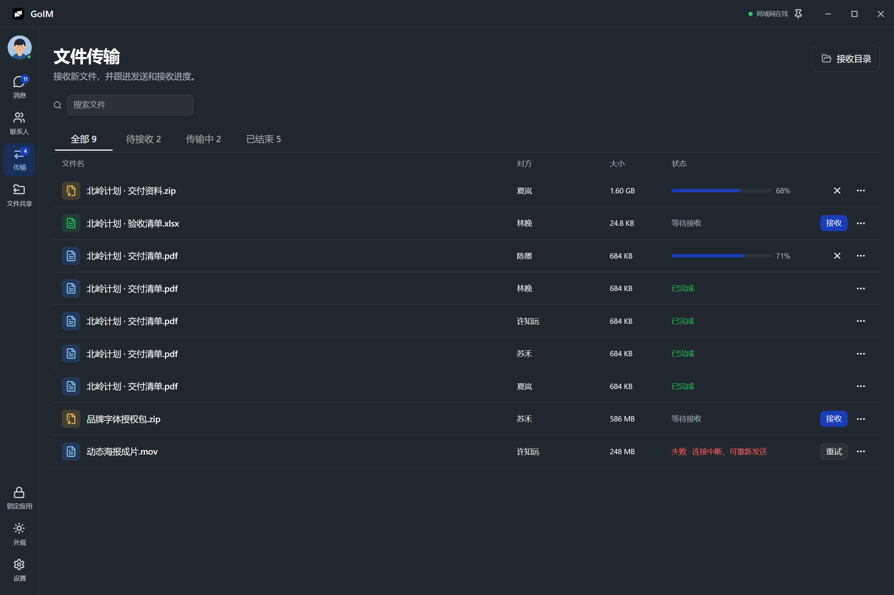
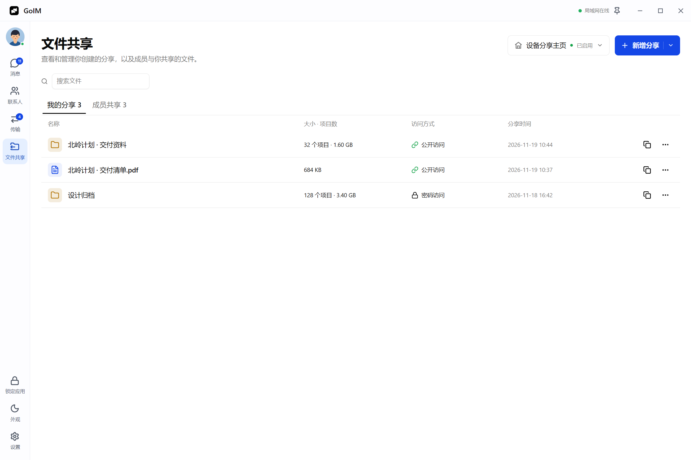
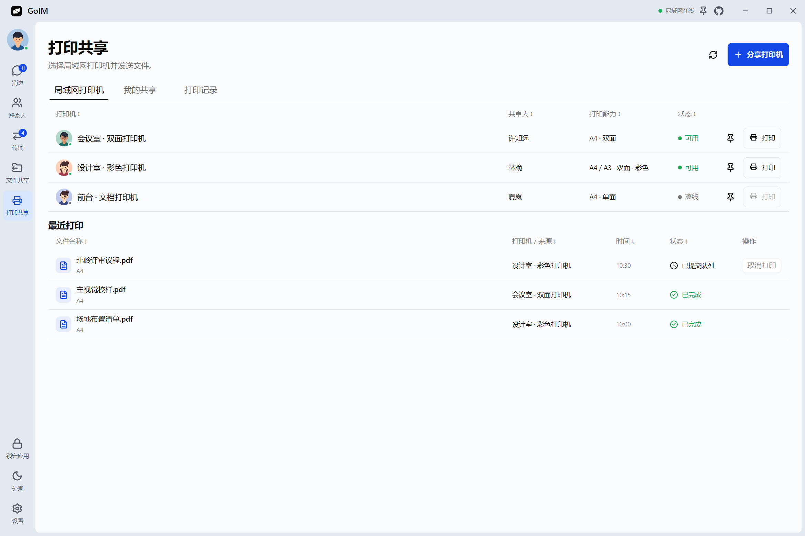

<div align="center">
  <p>简体中文 · <a href="README.en.md">English</a></p>
  
  <h1>GoIM</h1>
  <p><strong>局域网里的即时通讯与文件共享</strong></p>
  <p>
    <a href="https://ezreal-byte.github.io/GoIM/">官网</a> ·
    <a href="https://github.com/Ezreal-byte/GoIM/releases/latest">下载</a> ·
    <a href="#快速开始">快速开始</a> ·
    <a href="#旧版客户端兼容">兼容进度</a>
  </p>
  <p>
    <a href="https://qm.qq.com/cgi-bin/qm/qr?k=&amp;group_code=1084364974"></a>
    <a href="https://www.kdocs.cn/l/cdcdb0XI3TTt"></a>
    <a href="https://linux.do/"></a>
  </p>
  <a href="website/assets/screenshots/chat-dark.png">
    
  </a>
</div>

GoIM 是基于 Go 和 [Viva](https://github.com/vivaui/viva) 的桌面即时通讯工具。同一局域网内的设备可以直接发现彼此、聊天和传文件，聊天记录保存在本机。浏览器也可以打开分享链接，无需安装客户端。

<table>
  <tr>
    <td width="50%"><a href="website/assets/screenshots/contacts-light.png"></a><strong>联系人与分组</strong></td>
    <td width="50%"><a href="website/assets/screenshots/transfers-dark.png"></a><strong>文件传输</strong></td>
  </tr>
  <tr>
    <td width="50%"><a href="website/assets/screenshots/shares-light.png"></a><strong>桌面端文件共享</strong></td>
    <td width="50%"><a href="website/assets/screenshots/lan-share-directory.png"></a><strong>局域网 Web 文件分享</strong></td>
  </tr>
  <tr>
    <td width="50%"><a href="website/assets/screenshots/print-sharing.png"></a><strong>打印机共享</strong></td>
    <td width="50%"><a href="website/assets/screenshots/chat-light.png"></a><strong>浅色外观</strong></td>
  </tr>
</table>

## 功能

| 聊天 | 传输与分享 |
| --- | --- |
| 单聊、群聊、邀请和成员管理 | 普通附件由接收方确认，支持另存、取消、重试和续传 |
| 文字、表情和聊天图片，图片可在独立窗口缩放、旋转和保存 | GoIM 设备之间使用 TLS，并校验文件的 SHA-256 |
| 本地记录、会话搜索、未读、置顶与离线补发 | 文件和文件夹可生成链接及二维码，按项目设置访问密码 |
| 联系人分组、个人资料、应用锁与系统验证、两种主题与中英界面 | 设备分享主页可展示公开分享项目，并接收浏览器上传 |

单聊支持双向语音通话，包括来电接听、挂断、麦克风静音和扬声器开关；可在设置的「通话」页选择默认麦克风与扬声器，并分别调节输入和播放音量。

「打印共享」可分享本机打印机，其他成员在独立打印窗口选择文件和打印参数。常用打印机可在卡片上置顶；共享人可在「我的共享 → 编辑共享」设置、更换或关闭打印密码。首次使用受保护的打印机时验证一次，此后使用本机保存的专用授权；共享人改密后需重新验证。双方保留打印记录，验证通过前不会接收打印文件或提交系统打印队列。

使用 `Alt+A` 或聊天输入框里的剪刀截图。Windows 和 macOS 13.3 及以上使用随包提供的 Shotlet，支持标注、滚动截图、OCR 和贴图。确认截图后可直接粘贴到聊天。Shotlet 在 Windows 和 macOS 15 及以上提供录屏功能。Linux 和 macOS 13.0–13.2 使用 GoIM 内置的截图工具。macOS 首次使用 Shotlet 需允许屏幕录制。

## 安装

从 [GitHub Releases](https://github.com/Ezreal-byte/GoIM/releases/latest) 选择系统和架构。

| 系统 | 架构 | 下载格式 |
| --- | --- | --- |
| Windows | x64、ARM64 | `Setup.exe`、`.zip` |
| macOS 13 或更新版本 | Intel、Apple 芯片 | `.dmg`、`.zip` |
| Linux（X11 或 XWayland） | x64、ARM64 | `.deb`、`.tar.gz` |

Linux 安装包使用 Viva 的纯 Go 构建路径，不要求 GLIBC 2.32 或 2.34。发布校验只允许基础 libc、libpthread 和 libdl，并拒绝高于 GLIBC 2.31 的符号要求。系统仍需要提供 DEB 依赖中列出的 libc、X11、XKB、Vulkan 和 ALSA（`libasound2`）运行库；银河麒麟与统信系统将使用同一份兼容构建。

Linux 文件选择器优先使用桌面的 XDG Portal 或已安装的 zenity/kdialog。`.deb` 和 `.tar.gz` 均随包提供文件选择器及其运行库，系统未安装上述选择器时会自动使用，无需联网补装 zenity/kdialog。便携包请完整解压并保留 `lib/goim/file-dialog` 目录。遇到问题可在 **设置 → 关于** 中复制脱敏报告；导出时若选择器不可用，会自动保存到默认下载目录并提示路径（未配置下载目录时保存到应用数据目录的 `diagnostics` 子目录）。

Windows 使用 Viva 安装向导 `Setup.exe`，默认只给当前用户安装。从使用独立 MSI 的旧版本换用 Setup 时，请先卸载旧程序。GoIM 的本地资料和聊天记录保存在独立的用户数据目录。

压缩包需完整解压，保留 GoIM 与截图工具的相对位置。Windows 包未使用商业证书签名，macOS 应用使用 ad-hoc 签名且未经 Apple 公证。可用发布附带的 `SHA256SUMS` 校验下载。

### 软件更新

GoIM 默认在启动时及每 6 小时通过 GitHub Releases 检查稳定版，检查失败后 30 分钟重试。可在「设置 → 关于」关闭自动检查或随时手动检查；重新开启会立即检查。Windows 的当前用户 Setup 安装版，以及复制到可写目录的 macOS `GoIM.app`，可下载经签名校验的更新并在确认后安装重启。macOS 请先把 `.app` 从磁盘映像拖到可写的「应用程序」目录（如 `~/Applications`）。

Linux `.deb` 由系统包管理器更新。GoIM 提示新版本后，可下载对应架构的 `.deb` 并通过系统安装器升级。Windows 与 Linux 安装器会检查运行中的 GoIM；请先从系统托盘退出所有实例，再重试安装，避免新旧版本同时运行。应用内安装更新会先退出当前实例，再由更新助手完成安装和重启。

### 清除本机数据

「设置 → 关于 → 清除所有用户数据」会再次确认。选择「清除并退出」后，GoIM 先停止网络和后台任务、关闭数据库，再清除本机身份密钥、联系人、聊天记录、密码、设置和应用数据目录内的缓存。请重新启动软件；新建身份会被其他设备视为新用户。已下载、分享的原始文件及截图文件不会删除，不影响其他设备的数据。中途退出时，下次启动会继续完成已确认的清除。

## 快速开始

1. 两台设备连入同一个可互通的局域网并运行 GoIM。
2. 在「联系人」顶部搜索框筛选设备。自动发现受限时，点击侧栏底部的「手动连接」，输入对方 IP 或 `IP:47842`。
3. 发送文字、图片或文件。普通文件可在聊天或「传输」中接收。
4. 在「文件共享」添加文件或文件夹后，可以复制项目链接或出示二维码。要让对方一次浏览多个分享，选择「设备分享主页 → 启用设备主页」，再复制主页链接。对方在同一局域网用浏览器打开目录，即可查看和下载文件。点击右上角「上传文件」，或将文件拖入目录，即可上传给你。
5. 要使用同事共享的打印机，打开「打印共享」，按纸张、彩色和双面能力选一台可用设备，点击「打印」选择文件。「最近打印」会显示任务状态。

原生通信默认使用 TCP 47842，自动发现使用 IPv4 多播 `239.192.77.77:47841`。网页分享通过局域网 HTTP 提供，适用于可信网络。

### 通过内网 DNS 跨网段发现 GoIM

两个网段能够互访、但组播到不了对方时，可以指定一台常在线的 GoIM 作为发现入口。管理员只需为入口维护 DNS 记录。以发现域 `office.example` 为例，以下是 DNS 区域文件中的完整记录（地址换成入口的实际 IP）：

```dns
_goim._tcp.office.example.  60 IN SRV 0 0 47842 entry.office.example.
entry.office.example.       60 IN A   10.10.1.20
```

跨网段发现默认关闭。需要使用时，在入口和客户端的「设置 → 网络 → 高级网络设置 → 跨网段发现」填写相同发现域和能解析上述记录的内网 DNS 地址，保存并开启「自动发现联系人」。仅填写服务器时，默认查询 `_goim._tcp.goim.internal.`。服务器接受 IP 或 `IP:端口`，默认端口为 53。此设置只影响 GoIM。入口显示「本机是发现入口」，客户端显示「已连接发现入口」后，会自动发现同一域中在线登记的其他 GoIM，并通过原生 TLS 连接对方。入口和参与设备均需使用支持此功能的版本。

各设备需要能访问 DNS 和对方实际的 GoIM TCP 监听端口。入口只介绍地址，聊天与文件直接在设备之间传输。清空 DNS 地址并保存可退出发现域，隐身时暂停登记。此机制面向 GoIM 原生客户端。

## 应用锁与系统验证

先在「设置 → 安全 → 应用锁定」设置 GoIM 锁定密码，再开启「使用系统验证解锁」。开启时会要求输入当前 GoIM 密码；锁屏后可以点「使用系统验证」，也可以随时改用 GoIM 密码。系统验证取消或失败时应用保持锁定。

| 系统 | 可用的系统验证 |
| --- | --- |
| Windows 11 | Windows Hello，支持已配置的 PIN、指纹或人脸 |
| Windows 10 | 桌面 Hello 验证需要 Windows 11；系统验证不可用时继续使用 GoIM 密码 |
| macOS | Touch ID；没有 Touch ID 时使用当前 macOS 登录密码 |
| Linux | 当前版本暂不提供系统验证，开关禁用并显示原因；请使用 GoIM 锁定密码 |

GoIM 只接收系统验证成功或失败的结果，不读取、保存或传输系统密码和生物特征。Linux 旧设置中的系统验证会自动关闭，已有 GoIM 锁定密码保留；安装包内保留的 polkit 策略不代表该功能已启用。Windows Hello 必须先在系统中启用，不能把 Windows 账户密码当作 Hello 凭据直接交给 GoIM。

## 旧版客户端兼容

GoIM 会按对端自动选择协议。以下为 `0.1.16` 发布后在 `main` 上使用原版客户端验证的结果。

| 客户端 | 已验证的能力 | 详细进度 |
| --- | --- | --- |
| 内网通 `3.4.3055` | 自动发现，单聊与群聊双向收发文字、图片、文件和文件夹。单聊普通文件已验证超过 4 GiB。 | [内网通适配进度](docs/neiwangtong-compatibility-progress.md) |
| 飞鸽 IP Messenger `5.9.1` | 自动发现、双向中文消息和普通文件收发。 | [飞鸽适配进度](docs/ipmsg-compatibility-progress.md) |
| 飞秋 2013（`3.0.0.2`） | 指定回环地址时可发现对方，双向收发中文消息和中文名文件。跨机器广播发现仍待验证。 | [飞秋原版验证与限制](docs/ipmsg-compatibility-progress.md#windows-飞秋联调) |

可在「设置 → 网络」管理旧版客户端互通，也可用 `--no-compatibility` 启动仅使用 GoIM 协议的实例。

## 从源码构建

使用 CI 固定的 Go 工具链（当前为 1.27.3）。Go 会按 [`go.mod`](go.mod) 下载固定版本的 Viva。如果需要同时修改 Viva，可在本地创建包含两个仓库的 Go 工作区。

```sh
go test ./... -count=1
go vet ./...
go run ./cmd/goim
```

Windows 上，运行 `pwsh -File scripts/start-temp-dev.ps1` 可构建并启动使用独立配置和下载目录的开发客户端。加上 `-Loopback` 可关闭局域网发现和旧协议互通；运行 `scripts/start-dual.ps1` 可启动通过本机回环连接的两个客户端。

Windows 和 macOS 打包时，使用 CMake 3.20+ 从固定提交构建 Shotlet 的截图 SDK 助手。Windows 需要 Visual Studio 对应架构的 C++ 工具和 Windows SDK，使用 Visual Studio 2026 时需要 CMake 4.2+。macOS 需 Xcode 命令行工具。Windows Setup 另需 NSIS，可以用 `go run ./cmd/package --windows-setup` 构建。Linux 构建只需 GoIM 原有工具链，Shotlet 的 Wayland 捕获和原生选区窗口仍待实现。[Shotlet 源码](https://github.com/Ezreal-byte/shotlet)

`pwsh -File scripts/smoke-headless.ps1` 使用三个独立进程验证消息、文件传输和网页分享。`scripts/build.ps1` 可构建桌面程序和截图工具。各平台的打包与校验见 [Actions](https://github.com/Ezreal-byte/GoIM/actions/workflows/release.yml)。

版本说明按[发布规范](docs/releases/README.md)编写。

## 致谢

感谢 [t8y2 / Viva](https://github.com/vivaui/viva) 提供原生 Go 桌面框架。GoIM 的聊天窗口和桌面控件均基于 Viva 构建。

感谢 [imjakey / Shotlet](https://github.com/imjakey/shotlet) 提供开源截图工具。GoIM 在 Windows 和 macOS 上集成了基于 Shotlet 的截图助手。

## 许可证

[Apache License 2.0](LICENSE) · [第三方许可](THIRD_PARTY_NOTICES.md)
