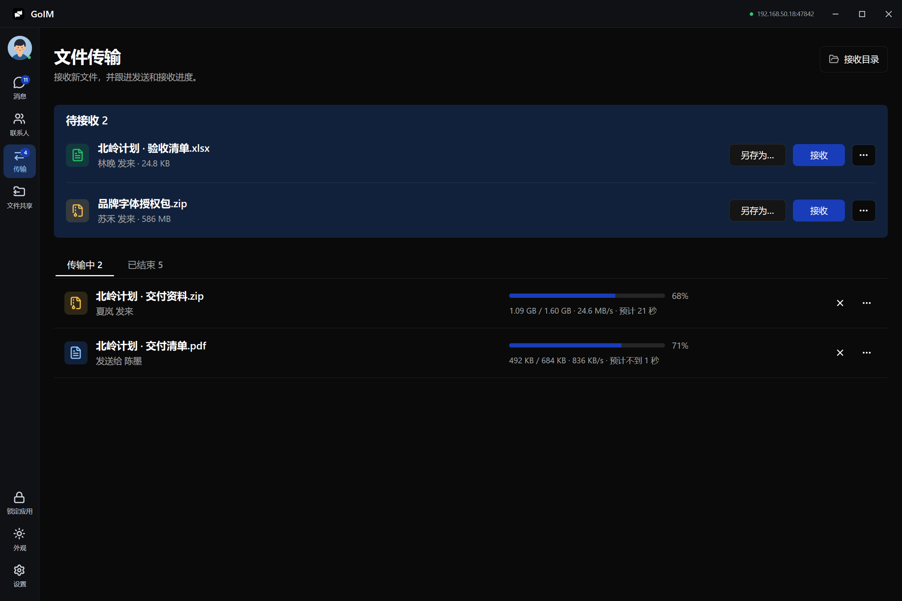
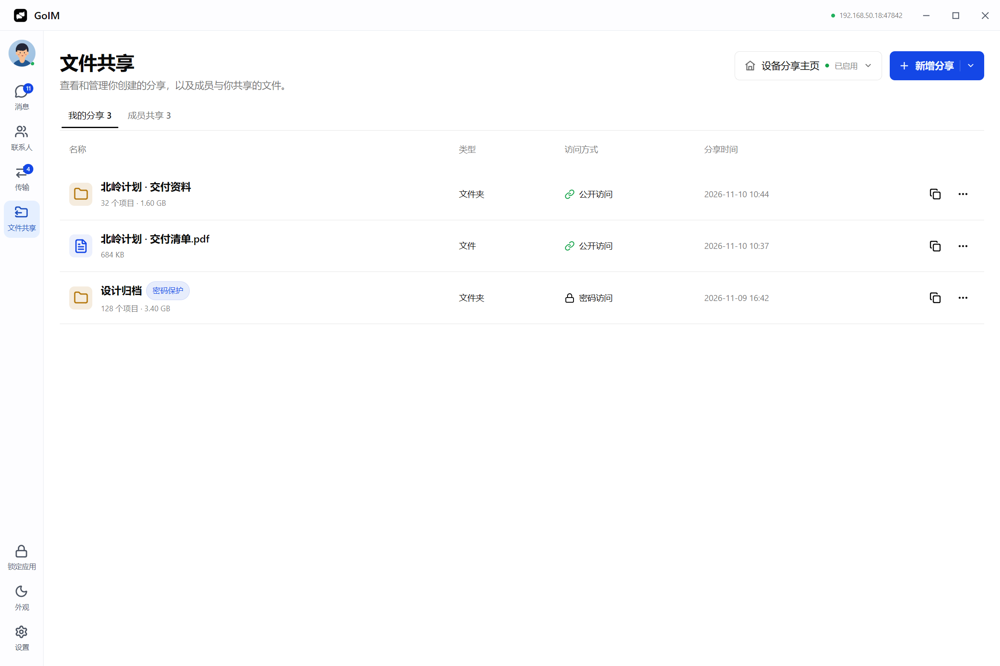

<!-- The gallery uses GoIM's native headless renderer with synthetic demo data. -->
<div align="center">
  <p><a href="README.md">English</a> · 简体中文</p>
  
  <h1>GoIM</h1>
  <p><strong>局域网里的即时通讯与文件共享</strong></p>
  <p>
    <a href="https://ezreal-byte.github.io/GoIM/">官网</a> ·
    <a href="https://github.com/Ezreal-byte/GoIM/releases/latest">下载</a> ·
    <a href="#快速开始">快速开始</a> ·
    <a href="#旧版客户端兼容">兼容进度</a>
  </p>
  <a href="website/assets/screenshots/chat-light.png">
    <picture>
      <source media="(prefers-color-scheme: dark)" srcset="website/assets/screenshots/chat-dark.png" />
      
    </picture>
  </a>
  <p><sub>GoIM 原生界面，由无头脚本使用演示数据渲染。</sub></p>
</div>

GoIM 是基于 Go 和 [Viva](https://github.com/vivaui/viva) 的桌面即时通讯工具。同一局域网内的设备可以直接发现彼此、聊天和传文件，聊天记录保存在本机。浏览器也可以打开分享链接，无需安装客户端。

<table>
  <tr>
    <td width="50%"><a href="website/assets/screenshots/contacts-light.png"></a><strong>联系人与分组</strong></td>
    <td width="50%"><a href="website/assets/screenshots/transfers-dark.png"></a><strong>文件传输</strong></td>
  </tr>
  <tr>
    <td width="50%"><a href="website/assets/screenshots/shares-light.png"></a><strong>文件共享</strong></td>
    <td width="50%"><a href="website/assets/screenshots/chat-dark.png"></a><strong>暗色外观</strong></td>
  </tr>
</table>

## 功能

| 聊天 | 传输与分享 |
| --- | --- |
| 单聊、群聊、邀请和成员管理 | 普通附件由接收方确认，支持另存、取消、重试和续传 |
| 文字、表情和聊天图片，图片可在独立窗口缩放、旋转和保存 | GoIM 设备之间使用 TLS，并校验文件的 SHA-256 |
| 本地记录、会话搜索、未读、置顶与离线补发 | 文件和文件夹可生成链接及二维码，按项目设置访问密码 |
| 联系人分组、个人资料、应用锁、两种主题与中英界面 | 设备分享主页可展示公开分享项目，并接收浏览器上传 |

截图支持自由框选、移动和缩放选区、标注与原分辨率复制。默认快捷键为 `Alt+A`，也可使用聊天输入框里的剪刀图标。

## 安装

从 [GitHub Releases](https://github.com/Ezreal-byte/GoIM/releases/latest) 选择系统和架构。v0.1.1 提供以下 14 个安装包和压缩包。

| 系统 | 架构 | 下载格式 |
| --- | --- | --- |
| Windows | x64、ARM64 | `Setup.exe`、`.msi`、`.zip` |
| macOS 13 或更新版本 | Intel、Apple 芯片 | `.dmg`、`.zip` |
| Linux（X11 或 XWayland） | x64、ARM64 | `.deb`、`.tar.gz` |

Windows 的 Setup 和 MSI 使用同一套安装内容，任选一种。压缩包需完整解压，保留 GoIM 与截图工具的相对位置。Windows 包未使用商业证书签名，macOS 应用使用 ad-hoc 签名且未经 Apple 公证。可用发布附带的 `SHA256SUMS` 校验下载。

## 快速开始

1. 两台设备连入同一个可互通的局域网并运行 GoIM。
2. 在「联系人」选中发现的设备。自动发现受限时，使用「手动连接」，输入对方 IP 或 `IP:47842`。
3. 发送文字或图片。普通文件可在聊天或「传输」中接收。
4. 要让手机或其他电脑用浏览器获取文件，在「文件共享」里添加文件或文件夹，然后复制项目链接或二维码。设备分享主页启用后也可接收上传。

原生通信默认使用 TCP 47842，自动发现使用 IPv4 多播 `239.192.77.77:47841`。网页分享通过局域网 HTTP 提供，适用于可信网络。

## 旧版客户端兼容

| 客户端 | 已验证的能力 | 边界 |
| --- | --- | --- |
| 内网通 3.4.3055 | Windows 与 VMware 客户端之间初步验证了发现、双向文字和普通单文件传输。修复版通过了 TCP 拉取报文和 GoIM 聊天文件卡片回归。 | 图片可按普通附件发送。内网通的内嵌图片、截图、表情、原生文件共享及群聊未实现互通。 |
| 飞秋 | 自动化测试覆盖扩展报头、中文编码、发现和标准 IPMSG 文件路径。 | 真实飞秋客户端及其不同版本仍待验证，私有扩展未纳入兼容范围。 |

自动发现失败时可手动输入旧版设备的 `IPv4:2425`。发现和文字使用 UDP 2425，文件使用 TCP 2425。同一台机器上的 GoIM、内网通和飞秋可能争用该端口，实测时每台机器仅保留一个启用兼容模式的客户端。标准 IPMSG 兼容链路没有 GoIM 原生 TLS，可用 `--no-ipmsg` 关闭。

## 从源码构建

使用 CI 固定的 Go 工具链（当前为 1.27.3）。在 GoIM 的同级目录准备固定版本的 Viva，并应用项目补丁。完整命令见 [Viva 构建说明](framework/README.md)。

```sh
go test ./... -count=1
go vet ./...
go run ./cmd/goim
```

Windows 可运行 `pwsh -File scripts/build.ps1` 生成桌面程序和截图工具。可用 `pwsh -File scripts/promo-headless.ps1` 重新生成演示截图。发布构建及各平台校验见 [Actions](https://github.com/Ezreal-byte/GoIM/actions/workflows/build.yml)。

## 许可证

[MIT](LICENSE) · [第三方许可](THIRD_PARTY_NOTICES.md)
