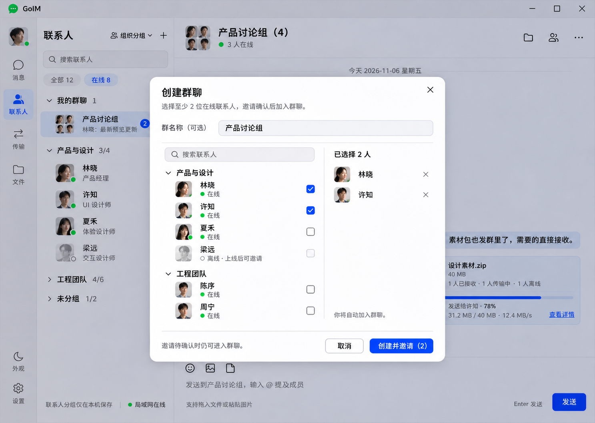
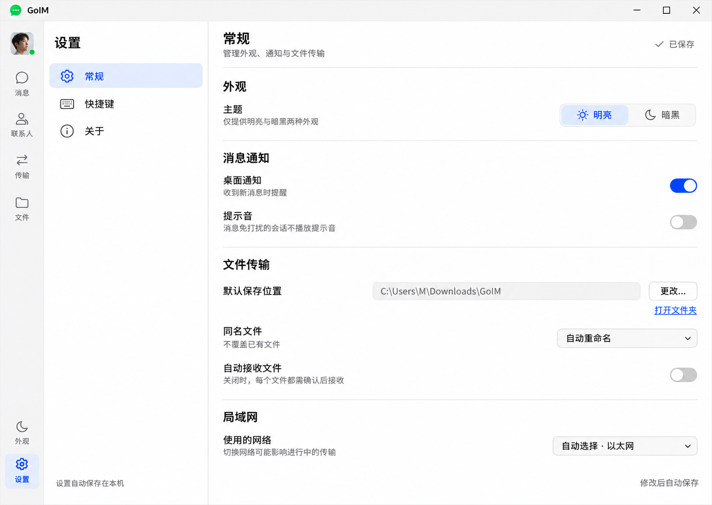

# GoIM 首期交互设计

日期：2026-11-06。状态：方案二的交互细化稿，供产品评审与后续 Go + Viva 实现使用。

本文与效果图描述预期行为；当前未实现可点击原型或通信功能。产品暂名 GoIM。

## 1. 已确定的设计基准

- 原生桌面、Windows 优先；无中心服务器，同一局域网成员在线直连。
- shadcn 风格，沿用 Viva 的中性色、蓝色主操作、细分隔线和小圆角。
- 仅明亮、暗黑两种主题；两个主题共用布局与状态，不增加彩色主题。
- 主窗口依次为图标导航、联系人或会话列表、聊天区。
- 聊天右上角使用文件夹、成员、更多三个图标按钮。文件夹按钮悬停提示“聊天文件”，无障碍名称也为“聊天文件”。单聊不显示群成员按钮。
- 联系人分组仅用于本机整理；“我的群聊”展示真正的多人会话，两者不互相替代。


## 2. 页面与浮层

| 入口 | 展示方式 | 返回行为 |
| --- | --- | --- |
| 联系人或会话中的“＋” → 创建群聊 | 居中弹窗 | 取消后返回原列表与聊天 |
| 群聊右上角成员图标 | 覆盖聊天区右侧的群聊信息抽屉 | 关闭后恢复原聊天位置 |
| 聊天右上角文件夹图标 | 聊天文件抽屉，含全部、图片、文件筛选 | 保留聊天状态 |
| 文件卡片“查看详情” | 文件详情抽屉 | 从文件列表进入时返回列表；从聊天卡片进入时返回聊天 |
| 最左侧设置图标 | 将联系人和聊天两栏整体切换为设置 | 点击消息或联系人恢复原会话、草稿、滚动位置 |

同一时刻只打开一个侧边抽屉；抽屉覆盖聊天区，不挤压联系人栏。抽屉中的上下文菜单先于抽屉响应 Esc。没有未提交内容时，点击遮罩或 Esc 可关闭浮层。建群或编辑群名已有未保存修改时，关闭需确认是否放弃。

## 3. 建群



### 3.1 选择与创建

1. 点击“＋” → 创建群聊，打开弹窗。
2. 可输入群名；不填时按所选成员昵称生成简短名称，超出部分省略。群名最多 30 个字符，去除首尾空白。
3. 左侧按本机联系人分组展示可选对象；搜索匹配昵称与本机备注。勾选不受搜索切换、分组折叠影响。
4. 右侧展示已选联系人，可逐人移除；自己自动加入，不占“已选人数”。
5. 至少选择两位在线联系人后启用“创建并邀请（N）”。离线联系人显示禁用原因“上线后可邀请”。
6. 提交时显示“正在创建…”，防止重复提交。先创建本机群记录，再分别发送邀请；单个邀请失败不撤销已建群记录。
7. 成功后进入新群会话，置于“我的群聊”顶部。已接受成员与待确认邀请分开统计；初始可只有自己已加入，邀请显示待确认。

### 3.2 邀请状态

| 状态 | 展示与可用操作 |
| --- | --- |
| 待确认 | 展示被邀请人；群主可撤回 |
| 已加入 | 移入正式成员列表，更新群人数和在线人数 |
| 已拒绝 | 展示拒绝状态；群主可重新邀请，避免自动反复重发 |
| 发送失败或连接中断 | 在对应联系人旁提示重试，不将其计入正式成员 |
| 已撤回 | 邀请失效；收到过旧邀请的客户端不能继续加入 |

被邀请人看到邀请人、群名、当前成员及“加入”“拒绝”。接受前不接收群消息或群文件。首期新成员从加入时开始接收消息，不自动获取加入前的完整历史。

## 4. 群成员管理


### 4.1 群聊信息抽屉

- 顶部展示群头像与群名；群名编辑控件仅群主可见。
- 成员列表支持搜索；自己优先，其余在线成员优先，再按昵称排序。身份标记、在线状态各自独立。
- 待确认邀请单列，不计入群成员总数，也不计入在线人数。
- 点击成员头像可查看资料；更多菜单提供查看资料、发消息，群主另有移出群聊。
- 个人选项包括我在群里的昵称、消息免打扰、置顶聊天。个人选项不修改其他成员的设置。
- 群主管理操作只在群主在线并完成状态同步后提交；其他成员仍可继续聊天。

### 4.2 权限

| 操作 | 群主 | 普通成员 |
| --- | --- | --- |
| 查看成员、发起单聊、发送群消息和群文件 | 支持 | 支持 |
| 修改自己的群昵称、免打扰、置顶 | 支持 | 支持 |
| 修改群名、邀请或移除成员 | 支持 | 首期不提供 |
| 查看自己发出的文件传输情况 | 支持 | 支持 |
| 转让群主、解散群聊 | 支持 | 不提供 |
| 退出群聊 | 先转让群主，或选择解散 | 直接确认退出 |

### 4.3 重要操作

- 改群名：点击编辑，原位输入或小弹窗编辑，“保存”提交，“取消”放弃；同步完成后发一条轻量系统提示。
- 移出成员：二次确认明确对象；确认后停止其新的群消息和未完成文件分发。无法删除对方此前保存的历史和文件。
- 邀请：复用建群联系人选择器，排除已加入和已有待确认邀请的联系人。
- 转让群主：选择已加入且在线的成员，对方确认后完成转让；对方拒绝或离线则保留原群主。
- 退出：确认后移出活跃群列表，保留本地历史；不再接收新的群消息。进行中的该群文件任务需提示并取消，其他会话任务继续。
- 解散：二次确认群名与影响，保留本机历史但群不可再发送。离线成员在重新连接并同步后获知，界面不承诺所有离线设备立即生效。
- 群主关闭应用不等于解散，也不影响其他在线成员继续通信；此时管理操作等待群主上线。

## 5. 群聊与群文件详情


### 5.1 群聊中的消息

- 收到的消息显示发送者昵称；自己的消息右对齐。
- 输入 @ 弹出已加入成员列表，支持搜索、键盘选择、Esc 关闭；首期不提供 @全体。
- 图片支持缩略图与大图查看；表情、文件与单聊共用输入工具。
- 发往离线成员的文字与文件邀请先保存在本机待补发。重连且存在可提供记录的在线成员时进行补齐；没有可用来源时明确提示等待，不承诺永久离线投递。
- “已送达”表示对端已接收消息记录，不代表已读；首期不提供已读回执。

### 5.2 文件卡片与列表

- 群内发送文件先分发文件邀请；默认由每位接收者独立确认，不自动把文件推给所有成员。
- 文件卡片展示文件名、大小及成员接收情况概览。卡片上的进度注明接收对象，避免误读为全群进度。
- 点击文件夹图标打开聊天文件列表，可按名称搜索，按全部、图片、文件筛选，时间倒序。
- 列表展示发送者、时间、文件大小、本机可用状态；本机已存在可打开，未接收进入详情选择接收。
- 文件来源不可用时说明“等待发送方上线”或“源文件已不可用”，不将历史文件记录假装成可下载的云存储。

### 5.3 文件详情的两种身份

| 区域 | 发送者视角 | 接收者视角 |
| --- | --- | --- |
| 文件信息 | 文件名、大小、类型、群、发送时间、本机源文件 | 文件名、大小、发送者、发送时间 |
| 状态 | 每位目标成员的独立状态，不统计自己 | 自己的接收状态和可用来源 |
| 主要操作 | 查看源文件、查看各任务、取消未完成传输 | 接收、拒绝、另存为；传输中取消；失败重试；完成后打开文件或文件夹 |
| 可见范围 | 自己所发送文件的任务详情 | 自己的任务；不展示其他成员的本地路径 |

首期以原发送方为文件来源；已接收成员不会在后台自动向别人转供文件。若后续支持成员转供，应有明确开关与来源标识。效果图“有文件持有者在线”在首期具体指原发送方在线且原文件仍可用。

### 5.4 接收状态

| 状态 | 展示与处理 |
| --- | --- |
| 等待接收 | 接收者可接收、另存为或拒绝 |
| 传输中 | 显示该成员的字节进度、速度、预计剩余时间；取消只影响该任务 |
| 校验中 | 进度完成但不标为已接收，等待完整性校验 |
| 已接收 | 校验完成，提供打开文件和打开文件夹 |
| 已拒绝 | 不自动再推送；接收者可主动重新申请 |
| 离线或连接中断 | 保留已接收部分，等待双方重新可连接后继续 |
| 已取消 | 明确由哪一端取消；重新接收需要主动操作 |
| 失败 | 展示具体原因与重试、选择其他位置等对应操作 |

批量取消需确认，并说明不会删除已完成的文件。源文件变更后不能直接沿用旧任务继续传输，应结束旧任务并重新发送。空间不足或目录不可写时允许选择其他目录；校验失败保留错误信息并提供重试。预计时间不可用时显示“计算中”，不显示假进度或 0 秒。

## 6. 设置：整体区域切换



### 6.1 布局与导航

```text
┌──────────┬─────────────────┬────────────────────────────────┐
│ 图标导航 │ 设置            │ 当前分类标题与内容             │
│          │                 │                                │
│ 消息     │ 常规            │ 选项名称、说明       对应控件   │
│ 联系人   │ 快捷键          │                                │
│ 传输     │ 关于            │                                │
│ 文件     │                 │                                │
│ …        │                 │                                │
│ 设置 ✓   │                 │                                │
└──────────┴─────────────────┴────────────────────────────────┘
```

- 最左侧图标栏固定保留；设置为选中状态，原导航项取消选中。
- 原联系人栏变成设置分类导航，仅常规、快捷键、关于三项；原聊天栏展示对应选项。
- 首次进入默认常规，此后返回上次分类，各分类独立保存滚动位置。
- 设置不是弹窗，没有关闭 X。点击消息、联系人、传输或文件进入对应模块；点击消息或联系人恢复之前会话的草稿和位置。
- 切换设置不暂停已有消息接收或文件传输，导航上的未读与传输提示继续更新。
- 只滚动右侧选项区域；标题和分类导航保持可见。
- 设置以分组标题、行布局、细分隔线组织，不把每组都包装成卡片。

### 6.2 常规

| 分组 | 选项与默认值 | 交互 |
| --- | --- | --- |
| 外观 | 明亮；可切换暗黑 | 双选切换，立即预览并保存；与导航栏外观按钮同步，仅两种主题 |
| 消息通知 | 桌面通知：开；提示音：关 | 独立开关；系统通知权限关闭时展示原因和打开系统设置入口 |
| 文件传输 | 保存目录：系统下载目录下 GoIM | 更改调用系统目录选择；先验证可写再保存；取消选择不修改 |
| 文件传输 | 同名文件：自动重命名 | 可选自动重命名、每次询问；首期不提供默认直接覆盖 |
| 文件传输 | 自动接收文件：关 | 开启时说明会自动保存来自已加入会话的文件；不自动执行或打开文件，可随时关闭 |
| 局域网 | 使用的网络：自动选择 | 可选具体可用网卡；显示可识别的名称与当前连接状态 |
| 启动与关闭 | 关闭主窗口：最小化到托盘 | 可改为退出应用；选择退出且有未完成任务时再次提示 |

主效果图展示外观、消息通知、文件传输与局域网；启动与关闭可在向下滚动后展示。个人昵称、头像从左侧本人头像入口编辑，不另增设置一级分类。昵称编辑使用保存与取消按钮。

网络切换时有活跃任务，默认提供“传输结束后切换”与“取消”；“立即切换”作为次要操作并说明任务将等待连接恢复。选择新保存目录仅影响后续任务，正在接收的文件继续使用原目录。自动接收开关仅影响之后的新邀请，不自动批准已在等待的文件。

### 6.3 快捷键

与常规共享整个设置布局，左侧“快捷键”选中，右侧标题为快捷键。右侧为“操作／按键／作用范围”的行列表，分为消息编辑、导航与搜索、窗口控制。右上角提供恢复默认。

| 操作 | 默认按键 | 范围与规则 |
| --- | --- | --- |
| 发送消息 | Enter | 可改 Ctrl+Enter；Shift+Enter 始终换行 |
| 会话内搜索 | Ctrl+F | 当前会话；搜索框已有焦点时全选查询 |
| 快速查找联系人或会话 | Ctrl+K | 应用内 |
| 创建群聊 | Ctrl+Shift+N | 应用内 |
| 打开设置 | Ctrl+, | 应用内 |
| 显示或隐藏主窗口 | 未设置 | 可选全局快捷键，注册成功后才生效 |

- 点击按键控件进入录制状态，提示“请按下组合键”，显示保存、取消；Esc 放弃录制，清除按钮表示未设置。
- 同作用范围发生冲突时指出冲突操作，禁用保存；不自动覆盖另一个绑定。
- 系统保留或全局注册失败时保留旧快捷键，说明“此组合键不可用，请换一组”。
- 恢复默认需确认，仅重置快捷键；可以取消，不影响其他设置。
- 中文输入法正在组词或候选确认时，Enter 先交给输入法，不能误发消息。发送设置变更同步更新输入框提示。

### 6.4 关于

左侧“关于”选中。右侧顶部展示 GoIM 名称、小图标和一句用途说明，下方按行展示应用版本、构建信息、Go/Viva 版本（从实际构建产物取得，不写死示例版本）。

- 复制版本信息：复制可供故障反馈的版本文本，轻提示“已复制”，不包含聊天内容、联系人、文件路径或本机地址。
- 开源许可：在应用内只读查看许可证及第三方依赖许可。
- 官网或项目地址：只有真实配置后才显示；点击使用系统浏览器。
- 首期不增加账号登录、云同步或自动检查更新。无互联网时关于页仍完整可用。

### 6.5 保存反馈

- 开关、选择、主题、已确认目录选择即时保存，标题旁短暂显示“保存中”→“已保存”；无修改时不重复提示。
- 昵称、群名和快捷键录制等存在编辑过程的字段，使用明确的保存与取消操作。
- 保存失败就地显示原因、保留可重试状态；失败的开关或选择恢复上一次已保存值，不伪称保存成功。
- 不使用整个设置页的统一保存按钮，也不在普通分类切换时弹出无意义的保存确认。

## 7. 通用视觉与可访问性

- 字号以 14–16px 正文、12px 辅助信息为基准；常规控件圆角约 7.5px，浮层和文件容器约 11px。
- 明暗主题仅切换语义颜色，不改变尺寸、间距、状态文案与操作位置。
- 所有图标按钮具备悬停提示、键盘焦点与明确的无障碍名称。状态既用文字或图标，也可辅以颜色，不仅靠红绿区分。
- Tab 顺序与视觉顺序一致。弹窗限制焦点在内部，关闭后归还触发控件；抽屉打开后焦点进入标题或首个操作。
- 长群名、文件名和本地路径省略显示并可查看完整内容，不将主要操作挤出容器。
- 主栏建议宽度为导航约 68px、第二栏约 300px，其余为主内容；以窗口逻辑尺寸为准，效果图不是逐像素实现规格。

## 8. 后续原型验收场景

1. 勾选联系人后搜索其他人，之前选择仍保留；少于两人不能创建。
2. 一人接受邀请、一人拒绝，群成员与待确认数量正确，群聊仍可使用。
3. 普通成员不见移除、转让和解散操作；群主离线不阻断其余成员聊天。
4. 三名接收者分别完成、传输中、离线时，卡片和详情显示一致；取消一个任务不影响另外两人。
5. 接收方磁盘不足、源文件消失、网络中断、同名文件各有对应恢复操作。
6. 从有草稿和滚动位置的群聊进入设置，再返回时状态保留，后台传输继续。
7. 设置三个分类切换时仅右侧内容与选中项变化，没有联系人或聊天区域残留。
8. 明暗切换与导航栏外观按钮同步；快捷键冲突无法保存；中文输入法确认不发送消息。
9. 保存失败明确反馈，关于页离线可查看；抽屉、菜单、弹窗按层级响应 Esc。

这份清单用于之后的交互原型验收，当前效果图不代表上述功能已实现。
